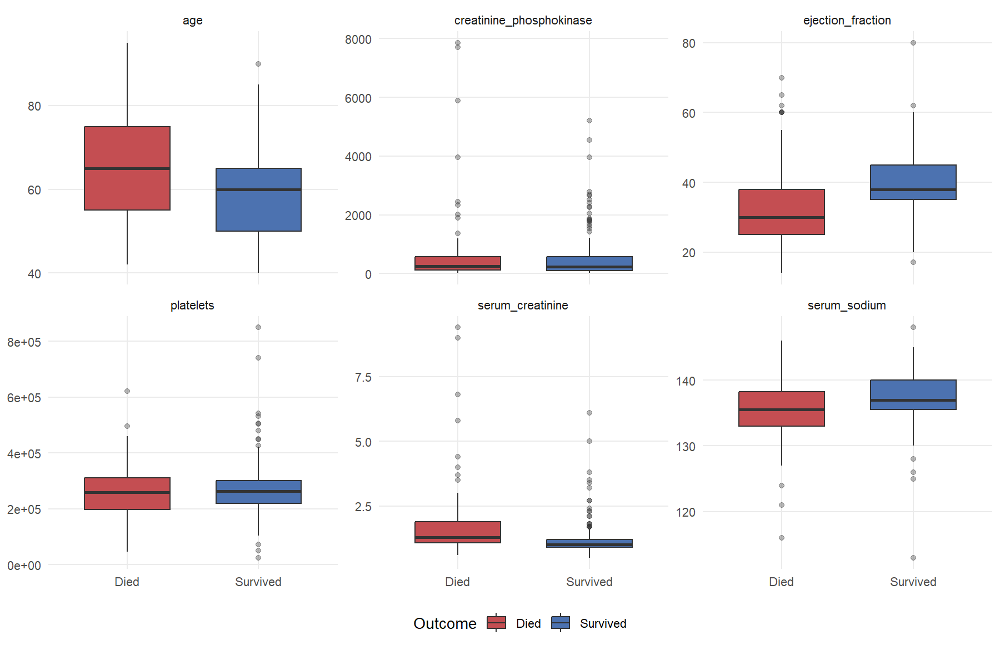
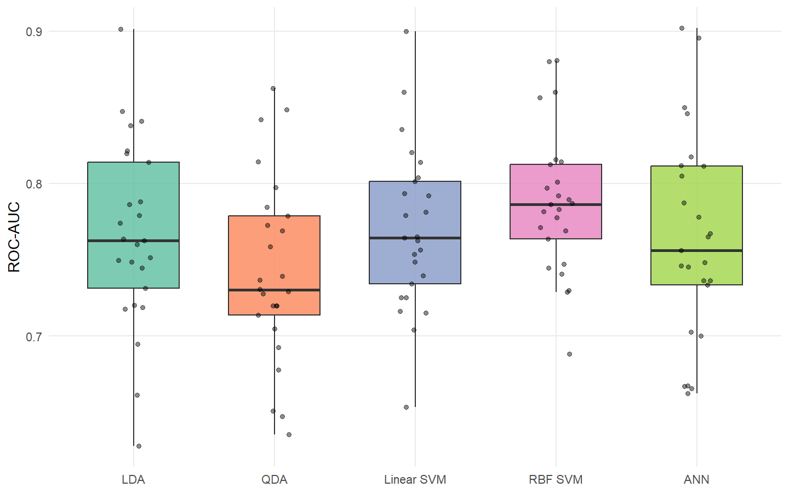
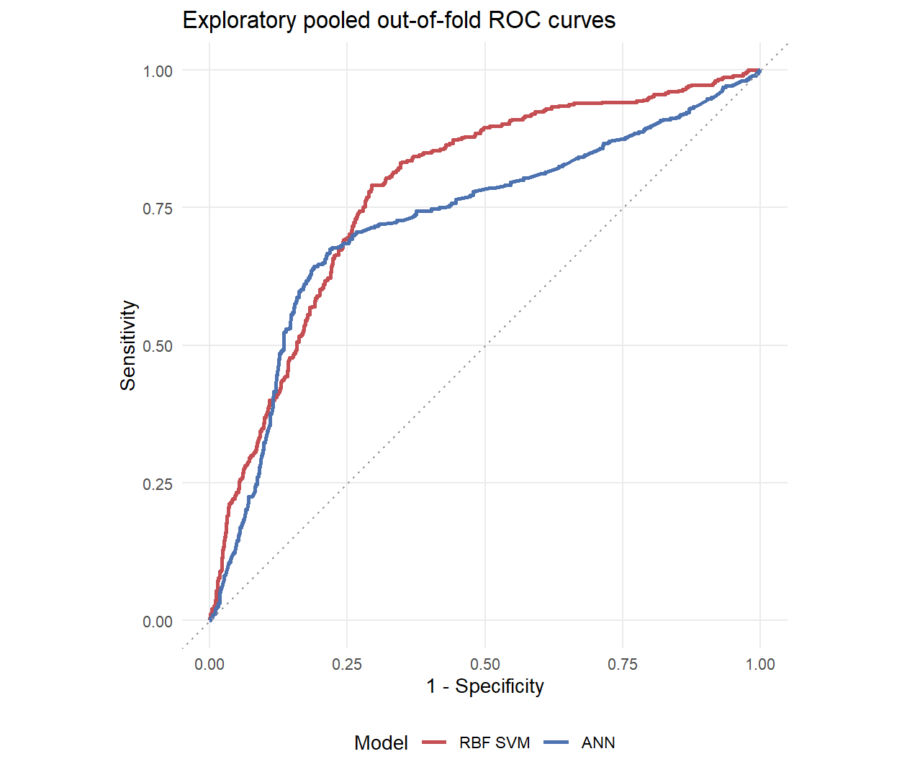

# Heart Failure Model Validation

## 심부전 사망 분류모델의 검증 설계 개선 및 성능 비교

이 프로젝트는 대학 다변량통계학 과제에서 LDA, QDA, SVM, ANN을 비교한 분석에서 시작했습니다.
포트폴리오 검토 과정에서 모델별 평가 방식이 달라 성능을 직접 비교하기 어렵다는 문제를 확인했습니다.
특히 RBF SVM의 2.68% 오분류율은 학습 데이터 재예측(training-set prediction) 결과였습니다.
이에 모든 모델을 동일한 반복 교차검증(Repeated Cross-Validation) 조건에서 다시 평가했습니다.
ROC-AUC뿐 아니라 민감도(Sensitivity), 특이도(Specificity), 균형정확도(Balanced Accuracy)를 함께 비교하여 모델별 trade-off를 재해석했습니다.

## 프로젝트 핵심

- 서로 달랐던 모델 평가 방식을 동일한 검증 조건으로 통일했습니다.
- 학습오차(training error)를 일반화 성능으로 해석했던 문제를 발견하고 수정했습니다.
- ROC-AUC, 민감도, 특이도, 균형정확도, 정확도(Accuracy)를 함께 비교했습니다.
- 원본 과제와 개선 분석을 모두 보존해 결론이 바뀐 과정을 투명하게 기록했습니다.

## 1. 프로젝트 개요

이 저장소는 제출 당시의 원본 과제와 이후 수행한 검증 업데이트를 분리해 보존합니다.
원본에서는 LDA, QDA, SVM, ANN의 성능이 서로 다른 평가 조건에서 산출되어 직접 비교하기 어려웠습니다.
개선 분석은 기존의 다섯 모델과 6개 연속형 임상변수를 유지하되, 모든 모델에 동일한 resampling fold를 적용했습니다.

프로젝트의 목적은 성능을 유리하게 다시 만드는 것이 아니라, **검증 설계(validation design)를 개선하여 공정한 비교 기준을 만드는 것**입니다.

## 2. 데이터셋

사용 데이터는 **Heart Failure Clinical Records**이며 총 299명의 기록을 포함합니다.

- 사망 96명 / 생존 203명
- 원본 데이터셋의 predictor 12개
- 이번 분석에 사용한 연속형 임상변수 6개
- 분석 변수의 결측값 없음

사용 변수는 age, creatinine phosphokinase, ejection fraction, platelets, serum creatinine, serum sodium입니다.

원본 데이터의 `time`은 추적기간(follow-up duration)을 나타냅니다. 이를 일반 predictor로 사용하면 결과와 관련된 추적 정보가 분류 과정에 섞일 수 있어 모델에서 제외했습니다. 이 프로젝트는 시간-사건 모형을 적합하는 분석이 아니며, 특정 시점의 사망확률을 예측하지도 않습니다.

탐색적 분석에서 사망군은 평균적으로 더 고령이었고, ejection fraction은 낮았으며, serum creatinine은 높고 serum sodium은 낮았습니다. 이는 **관찰된 집단 차이(observed group differences)**이며 인과효과나 독립적인 위험요인을 의미하지 않습니다.



## 3. 분석 질문

> LDA, QDA, SVM, ANN을 동일한 resampling design에서 평가할 때, 모델별 판별 성능과 오류 특성은 어떻게 달라지는가?

## 4. 기존 분석과 검증 문제

원본 결과는 다음과 같은 이유로 직접 비교하기 어려웠습니다.

- LDA와 QDA는 Leave-One-Out Cross-Validation을 사용했습니다.
- Linear SVM과 RBF SVM은 학습 데이터에 대한 재예측 결과로 성능을 계산했습니다.
- ANN은 한 번의 60:40 train/test split을 사용했습니다.
- ANN은 전체 데이터를 표준화한 뒤 분할하여 test set 정보가 전처리에 반영됐습니다.
- QDA prior가 factor level 순서와 반대로 전달됐습니다.

따라서 RBF SVM의 2.68% 오분류율은 unseen data에 대한 성능 추정치가 아니라 training error였습니다. 이 문제는 원본에서 조용히 수정하지 않고 공개용 coursework와 [validation_changes.md](docs/validation_changes.md)에 그대로 기록했습니다.

Henze-Zirkler 검정에서는 다변량 정규성이 지지되지 않았고, Box's M test에서도 공분산 동질성이 기각됐습니다. LDA와 QDA는 교육적 비교를 위해 유지하지만 결과는 이러한 가정 위배를 고려해 해석해야 합니다.

## 5. 개선한 검증 설계

- 층화 5-fold 교차검증(Stratified 5-fold Cross-Validation)
- 5회 반복, 총 25개 resample
- 모든 모델에 동일한 training fold 적용
- centering과 scaling을 각 training fold 내부에서 추정
- 사망(`Died`)을 positive class로 명시
- ROC-AUC를 tuning 지표로 사용
- 민감도, 특이도, 균형정확도, 정확도를 함께 보고
- fold 생성과 각 모델 학습 전 seed를 1로 고정

새로운 모델을 추가하거나 여러 seed를 탐색하지 않았으며, 성능 경쟁을 위한 추가 tuning도 수행하지 않았습니다.

## 6. 주요 결과

아래 수치는 렌더링된 분석 결과와 동일합니다.

| Model | ROC-AUC | Sensitivity | Specificity | Balanced Accuracy | Accuracy |
|---|---:|---:|---:|---:|---:|
| LDA | 0.766 | 0.391 | 0.903 | 0.647 | 0.739 |
| QDA | 0.743 | 0.275 | 0.897 | 0.586 | 0.698 |
| Linear SVM | 0.770 | 0.370 | 0.909 | 0.640 | 0.736 |
| RBF SVM | 0.788 | 0.562 | 0.818 | 0.690 | 0.736 |
| ANN | 0.764 | 0.612 | 0.827 | 0.720 | 0.759 |



## 7. 결과 해석

- **RBF SVM**은 평균 ROC-AUC가 가장 높았습니다.
- **ANN**은 민감도와 균형정확도가 가장 높았습니다.
- **LDA와 Linear SVM**은 특이도가 높지만 사망 환자 탐지 민감도가 낮았습니다.
- 모델 선택은 false negative와 false positive 중 어떤 오류를 더 중요하게 보는지에 따라 달라집니다.

따라서 Accuracy나 training error처럼 하나의 성능지표만으로 특정 모델이 우월하다고 단정하지 않습니다. 이 프로젝트의 핵심은 단일 순위가 아니라 **평가 목적에 따른 성능 trade-off**입니다.

### 탐색적 threshold 분석

반복 교차검증의 pooled out-of-fold prediction에서 RBF SVM의 AUC는 약 0.782, ANN은 약 0.725였습니다. 탐색적 Youden threshold는 각각 약 0.323과 0.215였습니다.

각 환자는 반복마다 한 번씩 pooled prediction에 포함되므로 동일 환자가 여러 차례 사용됩니다. 따라서 이 ROC와 threshold는 반복 예측의 기술적 요약이며, 독립 검증 결과나 임상적 cut-off가 아닙니다.



## 8. 원본 과제 대비 변경점

| 항목 | 원본 과제 | 개선 분석 |
|---|---|---|
| SVM 평가 | Training error | Repeated Cross-Validation |
| 모델 비교 | 서로 다른 validation scheme | 동일한 resampling fold |
| ANN 전처리 | train/test 분할 전 scaling | training fold 내부에서 추정 |
| ANN 구현 | `neuralnet` | 공통 `caret` workflow의 `nnet`; 원본 구현의 정확한 재현은 아님 |
| QDA prior | factor level 순서와 반대 | 공통 workflow에서 empirical prior 사용 |
| 평가 지표 | 주로 misclassification rate | ROC-AUC, Sensitivity, Specificity, Balanced Accuracy, Accuracy |
| 결론 | RBF SVM이 압도적으로 보임 | 평가 목적에 따라 모델 선택이 달라짐 |

## 9. 수행한 작업

- 원본 coursework의 모델별 검증 절차를 다시 검토했습니다.
- 서로 다른 평가 방식 때문에 성능을 직접 비교할 수 없음을 확인했습니다.
- training-set prediction에서 발생한 낙관적 평가를 식별했습니다.
- 동일한 층화 반복 교차검증 fold를 적용하도록 비교 설계를 수정했습니다.
- 전처리를 training fold 내부로 이동했습니다.
- Accuracy 하나가 아닌 여러 지표의 trade-off를 해석했습니다.
- 개선 분석의 한계와 원본 대비 변경점을 문서화했습니다.

## 10. 한계

- 표본은 299명이며 사망은 96건입니다.
- 관찰자료(observational dataset)이므로 인과관계를 설명하지 않습니다.
- 외부검증(external validation)을 수행하지 않았습니다.
- nested cross-validation을 수행하지 않아 hyperparameter 선택과 성능평가가 완전히 독립적이지 않으며, 일부 optimistic bias가 남을 수 있습니다.
- pooled OOF threshold 분석은 동일 환자를 반복 사용한 탐색적 결과입니다.
- 목표는 `DEATH_EVENT` 분류이며, 생존시간을 다루는 분석이 아닙니다.
- 특정 시점의 사망위험을 예측하지 않습니다.
- 원본 과제와의 비교를 위해 6개 연속형 변수만 사용했습니다.
- 업데이트 ANN은 공통 resampling workflow를 위해 원본의 `neuralnet` 대신 `nnet`을 사용했습니다.

이 저장소는 임상 적용, 의료기기 성능 또는 독립적인 위험요인 추론을 주장하지 않습니다.

## 11. 저장소 구조

```text
heart-failure-model-validation/
├── README.md
├── analysis/
│   ├── heart_failure_validation.Rmd
│   └── heart_failure_validation.html
├── original_coursework/
│   ├── analysis_original.Rmd
│   └── original_report_redacted.pdf
├── data/
│   ├── README.md
│   └── raw/
│       └── heart_failure_clinical_records_dataset.csv
├── figures/
│   ├── group_boxplots.png
│   ├── model_auc_resamples.png
│   └── roc_rbf_vs_ann.png
├── docs/
│   └── validation_changes.md
├── renv/
│   └── activate.R
├── renv.lock
├── .renvignore
├── .Rprofile
├── .gitignore
└── LICENSE
```

## 12. 재현 방법

저장소 루트에서 다음 명령을 실행합니다.

```r
install.packages("renv")
renv::restore()
rmarkdown::render("analysis/heart_failure_validation.Rmd")
```

분석은 저장소 내부의 상대 데이터 경로만 사용합니다. 실행 시 `figures/`의 PNG 3개와 분석 HTML이 생성되며, 패키지 버전은 `renv.lock`에 기록되어 있습니다. 생성된 HTML의 appendix에서 `sessionInfo()`를 확인할 수 있습니다.

## 13. 데이터 출처 및 라이선스

Dataset: **Heart Failure Clinical Records**

- [UCI Machine Learning Repository](https://archive.ics.uci.edu/dataset/519/heart+failure+clinical+records)
- Dataset DOI: [10.24432/C5Z89R](https://doi.org/10.24432/C5Z89R)
- Dataset license: CC BY 4.0
- Source study: Ahmad et al. (2017)
- Reuse and machine-learning study: Chicco and Jurman (2020)

CSV는 **CC BY 4.0** 조건으로 재배포합니다. 저장소의 코드와 작성 문서는 **MIT License**를 적용하며, MIT License가 데이터셋의 출처 표시 조건을 대체하지 않습니다.

## 14. 참고자료

- Ahmad, T., Munir, A., Bhatti, S. H., Aftab, M., & Raza, M. A. (2017).
  [Survival analysis of heart failure patients: A case study](https://doi.org/10.1371/journal.pone.0181001).
  PLOS ONE, 12(7), e0181001.
- Chicco, D., & Jurman, G. (2020).
  [Machine learning can predict survival of patients with heart failure from serum creatinine and ejection fraction alone](https://doi.org/10.1186/s12911-020-1023-5).
  BMC Medical Informatics and Decision Making, 20, 16.
